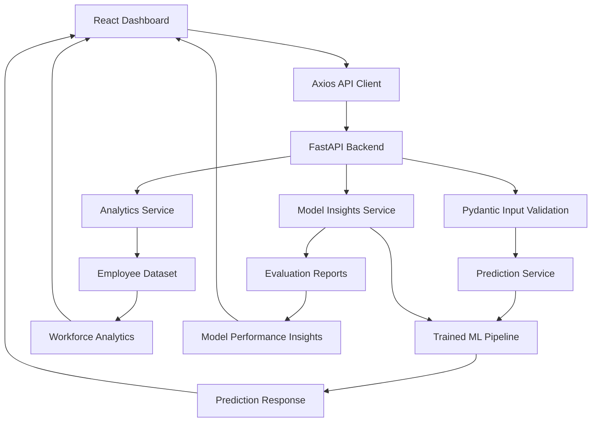

# WorkforceIQ

### Machine Learning-Based Employee Attrition Prediction and Workforce Analytics System

WorkforceIQ is an end-to-end machine learning and workforce analytics application that explores employee attrition patterns, evaluates predictive models, and presents interactive workforce insights through a modern web dashboard.

The system integrates machine learning, REST APIs, explainable AI, data visualization, and automated testing into a unified application.

> Educational prototype. Not intended for hiring, termination, compensation, or other employment decisions.

## Project Highlights

| Metric | Result |
|---|---:|
| Dataset population | 1,470 employees |
| Original dataset columns | 35 |
| Model input features | 30 |
| Encoded features | 51 |
| Algorithms evaluated | 4 |
| Selected model | Logistic Regression |
| ROC-AUC | 0.8032 |
| Average Precision | 0.5612 |
| Selected threshold | 0.75 |
| Dashboard modules | 6 |
| Automated API tests | 48/48 passed |

## Problem Statement

Employee attrition can affect organizational productivity, workforce stability, operational costs, and knowledge retention.

Traditional workforce reporting primarily describes historical employee departures. WorkforceIQ demonstrates how machine learning and interactive analytics can be combined to investigate attrition patterns and evaluate predictive approaches.

## Objectives

- Understand employee attrition patterns through exploratory data analysis.
- Identify workforce characteristics associated with attrition.
- Compare multiple machine learning algorithms.
- Address class imbalance during model development.
- Evaluate classification thresholds and their trade-offs.
- Provide model explainability through feature analysis.
- Integrate trained models with a REST API.
- Build an interactive workforce analytics dashboard.
- Validate system functionality through automated testing.

## Dashboard Modules

### 1. Workforce Overview

- Total employee population
- Attrition and retention rates
- Employee distribution
- Department-wise attrition
- Workforce demographics
- CSV, JSON, and printable reports

### 2. Department Analytics

- Department-level workforce distribution
- Attrition and retention comparison
- Average monthly income
- Job satisfaction statistics
- Department-level analytical insights

### 3. Risk Factor Analytics

Analysis of six workforce characteristics:

- Overtime
- Job role
- Job satisfaction
- Business travel
- Work-life balance
- Environment satisfaction

These analyses describe observed associations rather than causal relationships.

### 4. Employee Attrition Prediction

- Structured employee input form with 30 features
- Input validation
- Two demonstration employee profiles
- Machine learning classification
- Interactive model score visualization
- Configurable model artifact threshold
- Responsible-use disclaimer

### 5. Model Insights

- Algorithm comparison
- Classification performance metrics
- Interactive confusion matrices
- Threshold analysis
- Logistic Regression coefficient analysis
- Cross-validation permutation importance
- Model limitations

### 6. About the Project

- Project objectives
- Dataset information
- System architecture
- Development methodology
- Technology stack
- API documentation
- Responsible-use guidelines

## Technology Stack

| Layer | Technologies |
|---|---|
| Programming | Python, JavaScript |
| Machine Learning | Scikit-learn, XGBoost |
| Data Processing | Pandas, NumPy |
| Statistical Computing | SciPy |
| Exploratory Visualization | Matplotlib, Seaborn |
| Backend | FastAPI, Uvicorn |
| Input Validation | Pydantic |
| Frontend | React, Vite |
| Navigation | React Router |
| API Communication | Axios |
| Dashboard Visualization | Recharts |
| Icons | Lucide React |
| Model Persistence | Joblib |
| Testing | Pytest, FastAPI TestClient |

## System Architecture



## Dataset

The project uses the IBM HR Analytics Employee Attrition dataset.

Dataset source:

https://www.kaggle.com/datasets/pavansubhasht/ibm-hr-analytics-attrition-dataset

| Dataset characteristic | Value |
|---|---:|
| Employees | 1,470 |
| Original columns | 35 |
| Employees retained | 1,233 |
| Employees left | 237 |
| Observed attrition rate | 16.12% |
| Observed retention rate | 83.88% |
| Missing values | 0 |
| Duplicate records | 0 |
| Training samples | 1,176 |
| Testing samples | 294 |

The target variable is Attrition:

- No = 0
- Yes = 1

The dataset is imbalanced, with retained employees representing the majority class.

## Machine Learning Methodology

### Data Understanding

The dataset was examined for:

- Data types
- Missing values
- Duplicate records
- Target distribution
- Feature characteristics

### Exploratory Data Analysis

Employee attrition patterns were explored across departments, overtime, job roles, satisfaction levels, age, and other workforce characteristics.

### Data Preprocessing

The following identifier or constant-value columns were removed:

- EmployeeNumber
- EmployeeCount
- Over18
- StandardHours

Preprocessing included:

- One-hot encoding of categorical variables
- Standardization of numerical variables
- Stratified 80:20 train-test splitting
- Scikit-learn ColumnTransformer
- Pipeline-based preprocessing

The refined pipeline fits preprocessing independently within each cross-validation training fold to reduce data leakage.

### Model Training

Four algorithms were initially evaluated:

1. Logistic Regression
2. Decision Tree
3. Random Forest
4. XGBoost

Logistic Regression, Random Forest, and XGBoost were subsequently compared using refined pipeline-based cross-validation.

### Model Selection

Logistic Regression was selected based on its cross-validation average precision.

| Refined model | Average Precision | ROC-AUC |
|---|---:|---:|
| Logistic Regression | 0.6058 | 0.8273 |
| XGBoost | 0.5886 | 0.8007 |
| Random Forest | 0.5611 | 0.8076 |

Average precision was prioritized because the dataset contains an imbalanced target distribution.

## Classification Threshold Optimization

Out-of-fold training predictions were used to compare classification thresholds between 0.20 and 0.80.

The threshold of 0.75 achieved the highest F1 score among the evaluated thresholds.

Threshold selection and its training F1 estimate used the same out-of-fold predictions. The selected threshold should therefore not be interpreted as independently validated or universally optimal.

## Model Evaluation

### Test Set Performance

| Metric | Threshold 0.50 | Threshold 0.75 |
|---|---:|---:|
| Accuracy | 75.17% | 85.03% |
| Precision | 34.88% | 54.29% |
| Recall | 63.83% | 40.43% |
| F1 Score | 45.11% | 46.34% |
| ROC-AUC | 0.8032 | 0.8032 |
| Average Precision | 0.5612 | 0.5612 |

### Confusion Matrix — Threshold 0.75

| Actual / Predicted | Not Flagged | Flagged |
|---|---:|---:|
| Retained | 231 | 16 |
| Attrition | 28 | 19 |

Compared with the default threshold, the selected threshold produced:

- 40 fewer false positives
- 11 additional false negatives
- Higher precision
- Lower recall

The majority-class accuracy baseline is approximately 84.01% on the test set.

Accuracy alone is therefore insufficient for evaluating the model.

The test set was examined during initial evaluation and subsequent diagnostic analysis. These results are not an independent external validation.

## Model Explainability

Two complementary approaches were implemented.

### Logistic Regression Coefficients

Coefficient analysis examines the direction and magnitude of relationships learned by the fitted model.

### Permutation Importance

Permutation importance was calculated across five stratified cross-validation folds using validation data and average precision as the scoring metric.

The leading features included:

| Feature | Mean Importance |
|---|---:|
| OverTime | 0.1479 |
| JobRole | 0.1151 |
| TotalWorkingYears | 0.1040 |
| BusinessTravel | 0.0533 |
| YearsWithCurrManager | 0.0533 |

Feature importance measures predictive contribution under the evaluated model and dataset. It does not establish causation.

## Key Workforce Findings

- Overall observed attrition: 16.12%.
- Employees working overtime: 30.53% observed attrition.
- Employees not working overtime: 10.44% observed attrition.
- Sales recorded the highest department attrition rate at 20.63%.
- Research and Development recorded the highest number of departures at 133.
- Sales Representatives recorded an observed attrition rate of 39.76%.

These findings are descriptive statistics from the dataset and should not be generalized to real organizations without further validation.

## REST API Endpoints

| Method | Endpoint | Description |
|---|---|---|
| GET | / | API information |
| GET | /health | API health status |
| GET | /analytics/overview | Workforce summary |
| GET | /analytics/departments | Department analytics |
| GET | /analytics/risk-factors | Risk factor analytics |
| GET | /model/insights | Model evaluation and explainability |
| POST | /predict | Employee attrition classification |

Interactive API documentation is available at:

http://127.0.0.1:8000/docs

## Example Prediction Response

```json
{
  "status": "success",
  "result": {
    "model": "Logistic Regression",
    "attrition_score": 0.9014,
    "threshold": 0.75,
    "prediction": 1,
    "classification": "Flagged for Review"
  },
  "disclaimer": "Educational prototype. The attrition score is not a calibrated probability of resignation. Not for employment decisions."
}
```

## Project Structure

```text
Employee-Attrition-Prediction/
├── backend/
│   ├── __init__.py
│   ├── main.py
│   ├── analytics.py
│   ├── prediction.py
│   ├── schemas.py
│   └── model_insights.py
├── dashboard/
│   ├── public/
│   ├── src/
│   │   ├── components/
│   │   ├── data/
│   │   ├── layouts/
│   │   ├── pages/
│   │   ├── services/
│   │   ├── styles/
│   │   ├── utils/
│   │   └── App.jsx
│   ├── package.json
│   └── index.html
├── dataset/
│   ├── processed/
│   └── WA_Fn-UseC_-HR-Employee-Attrition.csv
├── models/
│   ├── best_model.pkl
│   ├── preprocessor.pkl
│   └── refined_model.pkl
├── reports/
│   ├── figures/
│   ├── model_comparison.csv
│   ├── refined_model_comparison.csv
│   ├── threshold_comparison.csv
│   ├── feature_importance.csv
│   ├── permutation_importance.csv
│   └── test_results.xml
├── src/
│   ├── 01_data_understanding.py
│   ├── 02_eda.py
│   ├── 03_preprocessing.py
│   ├── 04_model_training.py
│   ├── 05_model_evaluation.py
│   ├── 06_model_refinement.py
│   ├── 07_refined_evaluation.py
│   ├── 08_model_explainability.py
│   ├── 09_permutation_importance.py
│   └── 10_prediction.py
├── tests/
│   └── test_api.py
├── docs/
├── requirements.txt
└── README.md
```

## Installation and Setup

### Prerequisites

- Python 3.11
- Node.js compatible with Vite 8
- npm
- Git

The project was developed using Python 3.11.9 and Node.js 26.

### Backend Setup

From the project root:

```bash
python3.11 -m venv .venv
source .venv/bin/activate
pip install -r requirements.txt
```

Obtain the dataset from the linked source and place the CSV in the dataset directory if it is not already available.

Ensure the required model artifacts and evaluation reports are present.

Start the backend:

```bash
python -m uvicorn backend.main:app --port 8000
```

Backend URL:

http://127.0.0.1:8000

### Frontend Setup

Open a separate terminal:

```bash
cd dashboard
npm ci
```

Create a .env file inside the dashboard directory:

```env
VITE_API_URL=http://127.0.0.1:8000
```

Start the frontend:

```bash
npm run dev
```

Dashboard URL:

http://localhost:5173

### Production Build

```bash
cd dashboard
npm run build
npm run preview -- --port 5173 --strictPort
```

Stop any existing development server using port 5173 before starting the preview.

## Reproducing the ML Pipeline

Run the following commands from the project root with the Python environment activated:

```bash
python src/01_data_understanding.py
python src/02_eda.py
python src/03_preprocessing.py
python src/04_model_training.py
python src/05_model_evaluation.py
python src/06_model_refinement.py
python src/07_refined_evaluation.py
python src/08_model_explainability.py
python src/09_permutation_importance.py
python src/10_prediction.py
```

Model artifacts and evaluation reports are generated during these stages.

Only load trusted Joblib or pickle model files.

## Automated Testing

The project includes 48 automated API tests.

| Testing category | Tests passed |
|---|---:|
| API availability | 4/4 |
| Workforce analytics | 3/3 |
| Department analytics | 4/4 |
| Risk factor analytics | 8/8 |
| Model prediction | 6/6 |
| Invalid input validation | 14/14 |
| Model insights | 8/8 |
| CORS configuration | 1/1 |
| Total | 48/48 |

Latest recorded test execution:

- Passed: 48
- Failed: 0
- Warnings: 1 dependency deprecation warning
- Execution time: 2.59 seconds

Run the test suite:

```bash
python -m pytest tests/test_api.py -v
```

Generate an XML test report:

```bash
python -m pytest tests/test_api.py -v --junitxml=reports/test_results.xml
```

The automated tests validate software functionality and numerical consistency, not real-world model effectiveness or fairness.

## Frontend Performance

Frontend optimization includes:

- Route-based lazy loading
- Dynamic module imports
- Production asset bundling
- Reusable React components
- Loading and error states
- Backend health monitoring
- Responsive layout styling

The latest local production build completed successfully in 524 milliseconds, with no bundle-size warning.

## Report Export

The dashboard supports:

- CSV downloads
- Structured JSON exports
- Browser-based printing and PDF saving

Reports include workforce statistics, department analytics, risk factor analysis, model evaluation, threshold comparisons, and feature importance.

## Limitations and Responsible AI

- The dataset is limited in size and representativeness.
- The target distribution is imbalanced.
- The selected threshold misses a substantial proportion of attrition cases.
- Model scores are not calibrated resignation probabilities.
- Feature importance does not establish causation.
- Sensitive characteristics such as gender and marital status require fairness assessment.
- External validation and real-world monitoring have not been performed.
- The application does not provide production-grade authentication or access control.

WorkforceIQ is an educational machine learning prototype and must not be used to make employment decisions.

## Future Enhancements

- Independent external validation
- Probability calibration
- Fairness and bias assessment
- Model drift monitoring
- Automated frontend testing
- Secure authentication
- Containerized deployment
- Continuous integration

## Developer

**Rosvi S**

B.Tech — Artificial Intelligence and Machine Learning

SNS College of Technology, Coimbatore

- GitHub: https://github.com/Rosvi576
- LinkedIn: https://www.linkedin.com/in/rosvi/

## Acknowledgements

- IBM HR Analytics Employee Attrition dataset
- Scikit-learn
- FastAPI
- React
- Recharts
- Open-source Python and JavaScript communities

---

WorkforceIQ | Machine Learning and Workforce Analytics | 2026
