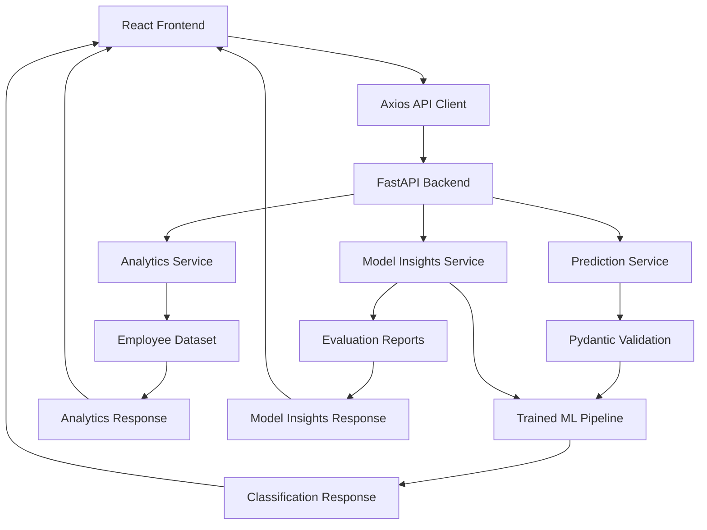

# WorkforceIQ — System Architecture

## Overview

WorkforceIQ follows a modular client-server architecture
that separates frontend presentation, backend services,
machine learning inference, and analytical data.

## Architecture Diagram

## Frontend Layer

- React and Vite
- React Router for navigation
- Axios for API communication
- Recharts for interactive visualizations
- Lucide React for interface icons
- Reusable UI components
- Route-based lazy loading
- CSV and JSON report exports
- Browser-based PDF printing

## Backend Layer

FastAPI exposes seven REST API endpoints.

The backend contains the following modules:

| Module | Responsibility |
|---|---|
| main.py | API routing and CORS configuration |
| schemas.py | Employee input validation |
| prediction.py | Machine learning inference |
| analytics.py | Workforce and department statistics |
| model_insights.py | Evaluation and explainability |

## Machine Learning Layer

The selected model is Logistic Regression.

The persisted pipeline combines:

1. Numerical feature standardization
2. Categorical one-hot encoding
3. Logistic Regression classification
4. Classification threshold of 0.75

The pipeline accepts 30 original features and
transforms them into 51 encoded features.

## Data Layer

The application uses local files:

- IBM HR Employee Attrition dataset
- Persisted Joblib model artifacts
- CSV evaluation reports
- Exploratory analysis figures
- XML automated testing report

A database is not required for the current prototype.

## Prediction Data Flow

1. User enters demonstration employee information.
2. Frontend validates the input.
3. Axios sends a POST request to FastAPI.
4. Pydantic validates the request schema.
5. The trained pipeline transforms the input.
6. Logistic Regression generates a model score.
7. The classification threshold determines the output.
8. The frontend displays the result and disclaimer.

## Error Handling

- Invalid input returns HTTP 422.
- Unavailable endpoints return HTTP 404.
- Frontend displays loading and error states.
- Backend availability is monitored through /health.
- Retry functionality supports connection recovery.

## Security and Limitations

- CORS restricts configured frontend origins.
- Environment variables configure the API URL.
- Input validation reduces malformed requests.
- Authentication and authorization are not implemented.
- Only trusted serialized model artifacts should be loaded.
- The system is an educational prototype and is not
  intended for employment decisions.
